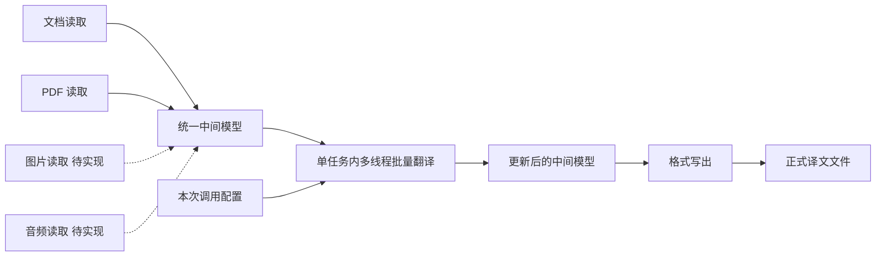

# AiNiee 后端统一中间模型与单任务接口改造计划

计划日期：2026 年 11 月 1 日。实施更新：2026 年 11 月 2 日。状态：本轮功能已实现，验收记录见文末。

2026 年 11 月 3 日调度调整：现已采用文档、图片、音频三个固定队列，同类 FIFO、异类最多三个顶层任务并发，增加 SQLite Job 记录和异步查询/取消接口。下文的“单顶层互斥、忙碌返回 409、无 Job/队列/数据库”等约束是历史方案，不再代表当前行为。任务内线程数与模型额度独立，不跨任务共享限流器；当前配置快照、代理应用、取消、断线与重启规则以 [任务队列说明](task_queues.md) 为准。历史主体与验收记录保留。

2026 年 11 月 3 日接口调整：PDF 读取已统一到 `POST /api/v2/read/document`，支持自动识别和 `options.pages`，原独立 PDF 读取 HTTP 接口已移除。下文保留原改造计划与验收记录；当前接口以 [后端说明](../README.md#统一中间模型接口) 为准。

本轮将项目缓存整理成统一中间数据模型，提供四个读取接口、一个翻译接口和一个写出接口。先跑通“文档或 PDF → 中间模型 → 翻译后的中间模型 → 正式译文文件”。图片、音频读取接口仅保留契约与空实现，返回明确的未实现错误。

沿用现有 FastAPI、JSON 缓存和格式读写器，采用单服务进程、单顶层任务执行。一个翻译任务内部继续使用现有多线程批量翻译流程，保留分块、线程数设置、限流和失败重试。这里的串行仅指暂不并行执行多个 job，不限制一个 job 内的批次并行。首版面向后端本机文件或共享路径，不增加 Job 系统、数据库、任务队列、MCP、文件上传下载和多任务并发调度。

PDF 翻译只保留 BabelDOC。按移除 Office 转换流程及依赖的范围，删除 Word/WPS 自动化转换链及其旧 .doc 入口；原生 DOCX、PPTX、XLSX 读写保留。

## 本轮交付范围

| 能力 | 本轮实现 |
| --- | --- |
| 文档读取 | 复用保留的非 PDF 格式 reader，统一返回新模型；移除 Office 转换的旧 .doc 入口 |
| PDF 读取 | 仅保留 BabelDOC 文字型 PDF 流程，统一返回新模型 |
| 图片读取 | 保留接口、请求模型和服务函数，返回 HTTP 501 |
| 音频读取 | 保留接口、请求模型和服务函数，返回 HTTP 501 |
| 模型翻译 | 接收中间模型与配置，在单任务内使用现有多线程批量翻译，返回更新后的模型 |
| 文件写出 | 接收中间模型，按各文件格式与输出选项生成正式文件 |
| 缓存兼容 | 新缓存使用统一模型，旧缓存可迁移读取，桌面保留功能继续可用；Office 类型按退役规则处理 |
| Office 清理 | 删除 Office 转换实现、注册入口、专属依赖、旧配置选项与界面功能 |

图片和音频接口不加载 OCR、ASR 或其他媒体依赖，不产生空项目，不报告成功。图片渲染、语音合成以及音频字幕生成不属于本轮交付。



## 统一中间模型

### 保留现有三层结构

继续以 CacheProject → CacheFile → CacheItem 作为内部模型，在现有类上增量扩展。对外称为统一中间模型；内部类名本轮无需全部重命名。

文件分组、顺序、原文、译文、翻译状态、语言统计、项目术语数据和格式元数据都属于模型内容。JSON 缓存与新 API 使用同一份序列化结构，不建立另一套独立存储模型。

| 层级 | 保留内容 | 新增内容 |
| --- | --- | --- |
| 项目 | project_id、project_type、project_name、files、stats_data、extra 等 | schema_version、translation_context |
| 文件 | storage_path、file_project_type、encoding、line_ending、items、extra 等 | file_id、media_type、source_ref、media_metadata |
| 条目 | text_index、source_text、translated_text、translation_status、model、lang_code、extra 等 | item_id、locator |

新增字段的具体约定：

- schema_version 使用整数 2；缺少版本的现有缓存按旧结构迁移。未来未知版本明确拒绝。
- file_id 与 item_id 在首次读取或迁移时生成，保存后保持不变。相同文字出现在不同位置时具有不同 item_id。
- text_index 保留用于旧桌面和现有算法；不会因翻译、过滤或写出重新编号。
- media_type 为 document、pdf、image 或 audio，定义在文件层，允许项目容纳多个文件。
- source_ref 保存源文件绝对路径和 sha256；storage_path 继续保存输出目录内的相对路径，两者职责分开。
- media_metadata 保存媒体属性。图片预留 width、height；音频预留 duration_ms；普通文档允许为空。
- translation_context 在读取后可为空，翻译时记录本模型译文的 source_language 与 target_language，不保存 API 密钥。首版一个模型只维护一套目标语言译文。
- locator 保存来源定位，按 kind 区分 document、pdf、image、audio；只填写读取器确实掌握的信息。

### 定位信息与格式信息

| 片段类型 | 定位信息 |
| --- | --- |
| 文档 | 结构路径或读取顺序；可逐步补充段落、表格单元格等定位 |
| PDF | 抽取顺序；读取器能提供时再填写页码与区域，不伪造坐标 |
| 图片 | 原图像素坐标中的区域多边形、阅读顺序；原图尺寸存文件层 |
| 音频 | 相对原音频的 start_ms、end_ms，约定区间为前闭后开；speaker_id 可选 |

保留项目、文件、条目原有的全部 extra 数据。本轮 locator 是补充字段，不替代已被 reader/writer 使用的格式信息。特别是 EPUB 的 HTML 与占位符、ASS 的文件头与样式、PPTX 的位置、RenPy 的行号与标签，均需原样往返保存。

translation_status 沿用现有数值约定。失败条目保留待翻译状态，失败原因放在调用报告中；不要为本轮临时增加一套与桌面冲突的状态枚举。

以下为省略部分既有字段的结构示例：

```json
{
  "schema_version": 2,
  "project_id": "project_001",
  "project_type": "Txt",
  "project_name": "sample",
  "translation_context": {
    "source_language": "english",
    "target_language": "chinese_simplified"
  },
  "files": {
    "sample.txt": {
      "file_id": "file_001",
      "media_type": "document",
      "file_project_type": "Txt",
      "storage_path": "sample.txt",
      "source_ref": {
        "path": "D:/inputs/sample.txt",
        "sha256": "<源文件的 SHA256>"
      },
      "encoding": "utf-8",
      "line_ending": "\n",
      "media_metadata": {},
      "extra": {},
      "items": [
        {
          "item_id": "item_001",
          "text_index": 1,
          "source_text": "Hello.",
          "translated_text": "",
          "translation_status": 0,
          "model": "",
          "locator": {
            "kind": "document",
            "index": 0
          },
          "extra": {}
        }
      ]
    }
  },
  "extra": {}
}
```

### 原文件依赖与缓存迁移

首版中间模型保存文本、结构信息和源文件引用，不将原文件二进制编码进 JSON。DOCX、EPUB、PDF 等格式写出仍需读取原文件。模型可以独立保存、加载和翻译；正式写出要求所需原文件仍可访问且内容匹配。

写出前集中校验 source_ref。原文件缺失或哈希变化时明确报错；迁移时找不到原文件的旧缓存仍可查看、翻译，但在依赖该文件的导出前需要重新定位并校验。不得悄悄使用另一个同名文件。

旧缓存没有历史哈希，不能仅对当前同名文件计算哈希就确认来源。迁移或重新定位时，先按对应 reader 核对缓存原文、顺序与格式定位，匹配后才建立哈希基线；无法核对时保留未验证状态，拒绝依赖该源文件的写出。

缓存迁移保留原 JSON 备份，补充新字段，原子保存新模型；迁移重复执行不会重新生成 ID。已有项目 ID、条目索引、译文、状态和 extra 均保留。原 input_path 保留兼容，后续写出以逐文件 source_ref 为准。

## 六个接口

新增模型接口统一放在 /api/v2 下。工作区接口在后续去事件化改进中改为明确路由，桌面连接协议升级为 2，具体见文末。下表为已接入的接口契约；图片、音频仍按本轮范围返回 501，其余读取接口的成功输出使用相同模型。

| 方法与路径 | 输入 | 输出与首版行为 |
| --- | --- | --- |
| POST /api/v2/read/document | path、options | 模型与读取报告；处理现有非 PDF 文档、字幕和游戏文本格式 |
| POST /api/v2/read/pdf | path、options | 模型与读取报告；处理文字型 PDF |
| POST /api/v2/read/image | path、options | HTTP 501，code 为 IMAGE_READ_NOT_IMPLEMENTED |
| POST /api/v2/read/audio | path、options | HTTP 501，code 为 AUDIO_READ_NOT_IMPLEMENTED |
| POST /api/v2/translate | model、config | 更新后的模型、翻译统计与失败明细 |
| POST /api/v2/write | model、可选 options | 实际生成的文件清单与写出报告 |

四个读取接口均预留单文件或目录输入，path 指后端机器上的路径。document 自动识别时排除 PDF、图片和音频，PDF 由专用入口处理。未知或不支持的格式在读取报告中说明；没有可用条目时返回明确错误，不创建假成功模型。

### 读取接口

文档读取复用 FileReader 和保留的各格式 reader；支持指定有效格式标识，或使用 AutoType。options 使用明确的请求字段，首版至少包含 format 和 exclude_rule。PDF 使用独立的 BabelDOC 请求选项，记录实际使用的解析参数，不再提供 Office 解析方式或回退路径。旧 .doc 文件提示先转换为 .docx 再导入。

```json
{
  "path": "D:/inputs/sample.txt",
  "options": {
    "format": "Txt",
    "exclude_rule": ""
  }
}
```

成功响应统一为 status、model、report。report 包含已读取文件数、条目数、跳过文件和警告。部分文件失败时返回 partial 并列出失败项；所有文件都无法读取时返回错误。

读取服务只返回模型，不替换 Runtime 当前桌面项目，也不修改全局输入目录配置。桌面需要切换项目时，由旧接口适配层显式接收模型并保存。

图片和音频采用上述 path 与 options 外形，首版 options 仅允许空对象。请求通过基础结构校验后直接返回 501；将来接入识别器时，扩展各自的强类型选项并返回同一模型。

### 翻译接口

内部函数为 translate_model(model, config) → 更新后的模型与报告。请求中的 model 是完整 JSON 对象，不是项目 ID。

config 沿用当前语言标识和翻译规则，定义明确的允许字段：source_language、target_language、provider_id、分块限制、上文行数、user_thread_counts、有限重试参数、提示词和术语规则。provider_id 引用已有后端接口配置；密钥由后端解析，不进入模型或响应。actual_thread_counts 继续按现有手动或自动线程数规则计算，并遵守该接口的 RPM 等请求限制。

参数解析顺序为后端默认值、选定接口配置、本次显式覆盖。开始时生成一份本次调用配置，后续批次不重新读写全局配置。TaskConfig 增加从解析结果初始化的入口，并拆开现有 prepare_for_active_platform 内部的读取、解析与持久化逻辑。

翻译过程按以下顺序运行：

1. 校验模型版本、ID 唯一性、目标语言及配置；复制为本次调用独占的数据。
2. 根据现有过滤规则标记处理范围，保留被排除条目和原有顺序。
3. 按文件、行数或 token 数分块，保留现有上下文与术语处理。
4. 使用现有 ThreadPoolExecutor 按 actual_thread_counts 并行执行批次，复用限流、提示词、模型调用、回复解析、占位符保护、校验与失败批次重试流程。
5. 按稳定条目标识回填结果，在线程安全保护下更新译文、状态、模型信息和统计；所有批次收尾后返回完整模型与报告。批次完成顺序不改变文件和条目的排列。

不改变原文、item_id、text_index、文件路径、locator 或格式 extra，不自动写出正式译文文件。默认跳过已有有效译文；需要覆盖时显式传 retranslate=true。已记录的目标语言与本次目标不同，默认拒绝；允许显式全量重译时，先在本次调用的模型副本中清空全部旧译文，重置已翻译状态并保留排除标记，再记录新目标语言并执行。失败条目保持空译文，避免混合两种语言；原输入模型保留不变。

业务上执行完毕时返回 HTTP 200，status 为 success、partial 或 failed，报告列出翻译成功、跳过、失败的数量与对应 item_id，并保留已完成结果。执行上下文请求取消时，服务以 cancelled 交付已完成部分；HTTP 连接仍存在时返回同样的模型与报告。配置无效等执行前错误使用相应非 2xx 响应。失败片段保持可重试，调用方可将返回模型再次提交；不自动反复重发整次 HTTP 请求。

新翻译接口不隐式覆盖同 project_id 的桌面缓存。调用方可保存返回的 JSON；桌面工作流负责将返回模型交给 CacheManager 保存。本轮不额外引入请求结果仓库或断线恢复服务。

### 写出接口

内部函数为 write_model(model, options=None) → 输出文件清单。必需输入只有模型；options 可指定 output_dir、译文或双语模式、文件名后缀、双语顺序、是否保留原编码及 overwrite。

未指定 output_dir 时，写入后端用户数据目录的 Outputs/<project_id>/。默认不覆盖已有文件。目标语言从 model.translation_context 获取；旧模型缺少必要语言信息时由迁移或显式输出选项补充。

写出按每个文件的 file_project_type 分派 writer。首先校验源文件和输出路径，再用 translated_text 与现有结构信息回填正式文件。未翻译或被排除的条目沿用原文，并在报告中说明。storage_path 必须为输出目录内的相对路径。

输出报告列出真实存在的文件及类型；写出函数不再仅返回 None。文件通过临时文件写入并完成替换后才列为成功；部分失败返回 partial 和已成功文件，全部失败返回 failed。重复调用可重新导出，且不得销毁后续写出仍需的资源。

写出不调用翻译模型，不修改原文件，也不回写译文。keep_original_encoding、目标语言、双语顺序和后缀等全部从本次参数获得，移除 writer_util 对全局 TaskConfig 的隐式读取。

image 与 audio 的正式输出处理器本轮同样不实现。手工提交这两类模型时，translate 可以处理其中已有的 source_text；write 返回明确的未实现格式错误，不能伪装成已生成译图或音频。

## PDF 专项处理

现有 BabelDOC reader 只提取字符串，writer 从原 PDF 重新运行排版流程，并通过顺序与原文匹配已有译文。本轮继续复用这条路径，不承诺缓存 JSON 已保存完整 PDF 版面中间表示。

- 读取时记录原 PDF 哈希、BabelDOC 版本、有效解析参数和抽取顺序摘要，保存在文件级 extra。
- 写出时使用相同参数并核对映射；版本、原文或顺序不兼容时明确失败，不能错位填入译文。
- 翻译不能删除、重排或修改原文条目，重复原文必须按原有位置正确区分。
- BabelDOC 临时文件放入本次操作专属临时目录，离开操作时仅清理该目录；后续导出可从源文件重新生成必要内容。
- 使用测试确认 PDF 写出阶段只消费已有译文，不触发付费翻译请求。
- 没有可复制文本的扫描件明确报告 SCANNED_PDF_NOT_SUPPORTED；本轮不自动转入尚未实现的图片接口。

### 删除 Office 转换链

改造前，OfficeConversionPdf 已未注册，但残留其类与类型常量；OfficeConversionDoc 仍通过 Word COM 转换旧 .doc，两者共用 OfficeFileConverter。本轮已删除整个转换链及旧 .doc 自动转换能力，保留直接处理 DOCX、PPTX、XLSX 的实现。

| 范围 | 具体清理项 |
| --- | --- |
| 转换实现 | 删除 office_conversion_reader.py、office_conversion_writer.py、converters/office_file_converter.py；确认无其他引用后删除 base_converter.py 及空的 converters 包 |
| 注册与类型 | 删除 FileReader、FileOutputer 中的 Office 注册及仅为其存在的平台判断；移除 ProjectType 中 OfficeConversionPdf、OfficeConversionDoc 的运行时支持 |
| 依赖 | 删除 requirements-backend.txt 中仅供该转换链使用的 pywin32；核查其他依赖清单与打包引用，移除 Office 专用收集项和无用配置 |
| 前端 | 移除 StartupPage 本地化中的“Doc 文档（需要 Microsoft Office）”、folder_drop_card.py 的 DOC 支持提示及旧格式选项；格式列表只展示当前支持项，PDF 只展示 BabelDOC |
| 配置 | 清理 translation_project 等字段中的 OfficeConversionPdf、OfficeConversionDoc 旧选中值，默认回退 AutoType 并说明原选项已移除；清理实际存在的 Office 专属选项，不影响通用线程、编码或 DOCX 设置 |
| 文档与打包 | 更新 files/accessors/README.md 等仍介绍 Office PDF 转换的说明；核查 Tools/pyinstall_macos.py 的 win32com/pythoncom 排除项及发布清单 |

当前没有发现独立的 Office PDF 配置开关，配置迁移重点是旧格式选择值及其界面功能。删除范围以实际引用为准；python-pptx、openpyxl、DOCX 的 ZIP/XML 处理依赖，以及 BabelDOC 自身依赖继续保留。

已有 Office 类型缓存保留原文、译文和格式标识供查看与迁移，不直接改名为 BabeldocPdf 或 Docx。需要正式 PDF 输出时，使用原 PDF 重新走 BabelDOC 读取；旧译文只能在原文与定位核对后复用。旧 .doc 文件需先转换为 .docx 再重新读取。写出接口收到退役类型时返回 FORMAT_REMOVED，不能启动 Office 或自动切换到另一套解析规则。

## 单任务执行与桌面兼容

仅运行一个后端服务进程、一个 API worker。read、translate、write 以及旧桌面的重操作共用一个执行保护；已有操作运行时，新操作立即返回 HTTP 409 BACKEND_BUSY。两个未实现的读取接口直接返回 501，不占用执行资源。

翻译服务内部保留当前多线程批量执行方式，包括 user_thread_counts、自动计算 actual_thread_counts、共享请求限流器、失败轮次与拆分重试、线程安全统计及批次完成回调。顶层互斥保护只阻止另一个 read、translate、write 或桌面重任务同时运行，不把内部线程数固定为 1。状态查询和健康检查保持可响应。

继续保留桌面的线程数配置功能；必要时将“并发任务数”说明为“单次翻译的并发请求数”，避免与未来多个 job 并行混淆。取消操作停止提交新批次、取消尚未运行的批次，并等待已运行批次完成或超时后再返回结果及释放顶层执行保护。

同步 HTTP 在操作结束后返回最终结果，不返回 202。使用同步路由或现有线程池包装执行，避免阻塞事件循环。客户端需设置覆盖整个操作时长的等待时间；先用小样本跑通，再验证长文本。

连接断开不表示正在执行的工作已经停止。执行保护由实际执行函数在 finally 中释放，不能由 HTTP 连接结束提前释放。本轮不承诺断线后可通过任务 ID 取回结果；客户端不自动重试整次翻译请求。

保留一个最小执行上下文，包含调用来源、取消信号和可选进度回调。旧桌面的停止命令仅作用于桌面发起的操作；不能停止新 API 操作或关闭其模型客户端。正常退出时等待或协作取消正在运行的操作。

Runtime 保留桌面当前项目和通知职责。新接口直接调用应用服务，TaskExecutor 按原有顺序调用相同的翻译与写出服务并返回结果，Runtime 完成持久化后发送具名通知；不维护第二套翻译实现。

桌面适配层通过批次完成回调接收已完成条目，更新自身 CacheManager 并沿用既有缓存保存机制。取消时也须交付已完成部分，保证停止后可以继续翻译。新 API 仍在调用结束时返回完整模型，不因此增加持久化任务或结果仓库。

线程池回调对条目、统计和缓存快照的更新沿用现有锁保护；后端通过 WebSocket 推送具名通知，前端在 Qt 主线程分发本地 UI 信号，避免多个批次同时完成时出现用量漏计、保存不一致或 UI 线程越界。

桌面 CacheItem/CacheFile/CacheProject 显示模型需同步保留新增字段，或在旧 API 适配层明确保留它们。不得在桌面编辑、保存后丢失 item_id、source_ref、locator 或 schema_version。

## 文件改动清单

尽量在现有目录中增量改造，不为本轮引入完整工作流框架。

| 文件或模块 | 计划改动 |
| --- | --- |
| domain/models/cache_project.py | 增加 schema_version、translation_context |
| domain/models/cache_file.py | 增加 file_id、media_type、source_ref、media_metadata |
| domain/models/cache_item.py | 增加 item_id、locator，保留既有状态和 extra |
| domain/models/intermediate.py 新增 | 定义来源引用、定位与模型校验规则；统一公共序列化契约 |
| infrastructure/cache.py | 新模型保存、旧缓存迁移、ID 持久化；分块算法不依赖当前项目单例 |
| application/read_service.py 新增 | 文档、PDF 读取与模型规范化；图片、音频占位函数 |
| application/translation_service.py 新增 | 接收模型与配置，复用现有多线程批量翻译，返回模型与报告 |
| application/write_service.py 新增 | 源文件预检查、按格式写出、返回文件清单 |
| domain/config/task_config.py | 增加显式配置初始化和解析入口，复用规则但不回写全局设置 |
| application/tasks/translator_task.py | 改用传入取消信号，处理调用独占的条目；保留现有翻译算法 |
| application/tasks/task_executor.py | 提取现有线程池批量执行流程供新服务复用；桌面工作流显式返回结果，通过上下文报告进度 |
| application/runtime.py | 新旧操作统一准入保护，区分调用来源，不让新 API 切换桌面项目 |
| api/pipeline.py 与 api/pipeline_schemas.py 新增 | 六个同步路由、强类型请求响应及稳定错误码 |
| files/readers 与 files/writers | 新字段适配、源文件引用解析、输出配置注入与实际文件报告 |
| Frontend/models/project.py | 保留新增结构字段，适配显示与编辑往返 |
| files/converters 与 office_conversion_reader.py、office_conversion_writer.py | 删除 Office 自动化转换链及无引用的转换基类 |
| FileReader、FileOutputer、ProjectType 与配置迁移 | 删除 Office 转换注册和选项，处理退役格式及旧配置 |
| requirements-backend.txt、打包脚本、StartupPage 本地化及格式说明 | 清理 Office 专用依赖、界面功能和文档，保留原生文档支持 |

现有 TXT、字幕、EPUB、DOCX、PPTX、表格和游戏格式的 reader/writer 保留。分块算法如从 CacheManager 提取，应直接接收模型，不通过创建会订阅全局事件的临时 CacheManager 来复用。

## 实施顺序与验收

### 第一步 固定模型并兼容旧缓存

扩展三层模型，建立新版本序列化、旧缓存迁移和小型格式样本。先保证结构完整往返，再改业务执行。

验收：旧缓存可读取；重复迁移 ID 不变；JSON 保存并重读后所有格式 extra、定位、状态与译文不丢；桌面读取新模型仍可显示和编辑。

### 第二步 打通文档读取与正式写出

先用 TXT 验证 read_document → 模型 → 手动填入译文 → write，随后验证 SRT/ASS、DOCX、EPUB，再逐项适配其余已有非 PDF 格式。

验收：文件真实生成；编码、换行、字幕时间、样式、占位符及非翻译结构保持；相同原文在不同位置可写回不同译文；未翻译条目不导致后续位置错位。

### 第三步 接入单任务内的多线程翻译

从 TaskExecutor 提取显式模型翻译服务，配置只在开始时解析一次，继续通过现有线程池执行批次、限流和失败重试，完成后返回模型。接入顶层操作保护和执行上下文，不另写一套单线程翻译算法。

验收：无需 Qt、无需切换当前项目即可翻译；read → translate → write 跑通；翻译不导出、写出不翻译；配置的多线程数和 RPM 限流生效；乱序完成的批次不会串译文；部分失败保留已有译文；运行中第二个重操作返回 409；取消后所有批次收尾才允许下一个操作。

### 第四步 完成 PDF 与六个接口

适配 BabelDOC 参数、映射校验和临时目录，删除整条 Office 转换流程、旧 .doc 入口及相关依赖和配置功能；挂载六个路由。图片、音频保持 501 空实现，既不安装识别依赖，也不进入真实媒体处理。

验收：未安装 Microsoft Office 与 pywin32 的环境仍可通过 BabelDOC 完成文字型 PDF 读取和正式 PDF 输出，不启动 Word 进程；重复写出可用；扫描件明确报错；旧 Office 类型和配置不再可选，历史缓存不被错误改名；原生 DOCX、PPTX、XLSX 可用；图片、音频接口返回各自稳定错误码；所有已实现接口使用同一模型。

### 第五步 接回桌面并收尾

旧桌面翻译和导出调用同一服务，补齐缓存保存、停止与继续、编辑、表格任务和事件兼容性回归。更新 Backend README 与请求示例，明确本地路径和同步调用限制。

验收：桌面保留格式的主流程可用；新 API 不覆盖桌面当前项目；桌面保存不会丢掉新字段；线程数配置保持生效；Office 转换入口及专属功能已清除，退役格式给出明确提示。

## 最低回归清单

使用临时目录、固定小型文件和模拟模型回复验证流程；BabelDOC 的 PDF 测试按环境单独执行，原生 DOCX、PPTX、XLSX 测试无需安装 Microsoft Office。

- 模型新旧版本兼容、稳定 ID、全部 extra 与定位字段的 JSON 往返。
- TXT、DOCX、EPUB、SRT/ASS 和文字型 PDF 的真实文件写出。
- 占位符、术语、原文顺序、重复文本、排除条目与部分失败的正确处理；切换目标语言后部分失败不会残留旧语言译文。
- 配置不回写、翻译不自动导出、写出不触发翻译请求。
- 原文件缺失或变化明确失败；旧缓存不能静默绑定未经匹配的同名源文件；输出路径有效；已有文件按覆盖选项处理。
- 单顶层任务执行、任务内多线程批量翻译；线程数与限流有效，乱序回调不改变条目顺序；忙碌时拒绝新重操作，取消或失败后等待所有运行批次收尾再释放执行保护。
- PDF 仅经过 BabelDOC；不依赖或启动 Microsoft Office；Office 专属依赖、格式注册、配置选项和界面功能已删除，原生 DOCX、PPTX、XLSX 功能保持。
- 图片和音频占位接口返回 501，缺少媒体依赖不影响后端启动。
- 桌面缓存、编辑、翻译、导出、停止与继续以及其他已有任务的兼容性。

本轮完成标准：调用方通过文档或 PDF 读取接口取得统一模型，将该模型和配置交给翻译接口，再把返回模型交给写出接口，得到可打开的正式译文文件；图片和音频保留未来接入所需的数据字段与接口位置。

## 实施与验收记录（2026-11-02）

上述五步已实现。六个 `/api/v2` 路由已挂载，图片和音频读取保持 501 占位；模型版本为 2，旧缓存有备份和原子迁移。新接口与旧桌面共用顶层执行保护和翻译、写出服务，翻译内部保留线程池、批量、限流和重试。Office 自动化转换、旧 `.doc` 入口及相关依赖已删除，原生 DOCX、PPTX、XLSX 保留。

本机验证环境为 Windows、Python 3.12、BabelDOC 0.6.4。启用 `AINIEE_TEST_REAL_PDF=1` 执行 `python -X utf8 -m pytest tests -q`，**85 项通过**：

- 24 项模型与缓存回归：稳定 ID、旧缓存备份迁移、字段往返、未来媒体定位、源文件引用校验，以及 XLSX 和 Trans 数值兼容。
- 15 项 API 与运行时回归：鉴权、类型校验、六个路由、互斥与停止归属、关闭准入、真实服务生命周期，以及 HTTP 和桌面共用服务的完整 TXT 流程。
- 33 项翻译回归：多线程批次、重试、取消与在途请求收尾、部分结果保留、规则与配置隔离、目标语言重译、执行回调异常、分块开关、桌面继续任务累计统计，以及临时词表覆盖和新旧规则配置歧义校验。
- 13 项文件回归：文档和字幕实际输出、源文件变化与旧缓存匹配、失败输出不发布、Office 退役、PDF 重复原文及重复写出映射，以及真实 BabelDOC 文字型 PDF 的读取与单语、双语输出。

`python -m compileall -q Backend Frontend tests` 和 `git diff --check` 通过。测试中的翻译回复使用模拟模型，不消耗付费模型额度；真实 PDF 测试使用已安装的 BabelDOC 模型和字体资产。另已验证扫描件返回 `SCANNED_PDF_NOT_SUPPORTED`。本轮未进行桌面窗口的人工交互验收，也未验证全部第三方模型提供商；已有后端协议和桌面适配通过自动化回归。

调用方式及本地路径、同步等待、无 Job 队列等边界见 [Backend README](../README.md)。

## 后续改进：业务去事件化（2026-11-02）

在第一阶段基础上，将后端业务控制改为明确的方法调用，持久化成功后才发送通知。保留前端本地 UI 信号和 WebSocket 进度、日志通道。

- 删除后端 `core/events.py`、`Base.EVENT`、全局 `Base.work_status`、执行器启动订阅和额外的启动线程包装。后端模块直接调用业务服务，不互相调用 HTTP。
- 删除 `/api/commands`、数字事件编号及 `update_event/done_event` 请求参数。桌面改用 `/api/tasks/translation`、`analysis`、`table/translate`、`table/polish`、`table/proofread`、`glossary/translate`、`api-test`、`stop` 以及 `/api/project/export`、`save`。
- TaskExecutor、SimpleExecutor、AnalysisTask、ProofreadTask 显式返回结果，通过 ExecutionContext 报告进度、交付批次结果和接受取消。分析及术语结果由 Runtime 显式保存，表格结果逐批保存，并兜底回收在途批次。
- CacheManager 提供显式的 `start_saving`、`stop_saving`、`save_to_file`、`close` 生命周期；写盘异常向调用方报告，通知回调失败不影响保存结果。
- 移除桌面跨端业务事件发送器。多文件表格翻译合并为一次提交，内部逐文件处理，保留每个文件内的批次并行。完成状态区分成功、部分失败、取消和异常。
- 桌面协议升级为 2，WebSocket 使用具名 `notification`，前后端需配套升级。停止只影响当前工作区操作；正式文件导出、读取和检查等待完成。停止或退出必须等待在途请求及保存线程收尾。
- 六个 `/api/v2` 模型接口的同步契约不变；工作区长操作保留 202 接受确认及通知，不引入并行 Job、队列或数据库。

新增回归覆盖显式服务独立调用、通知缺失或失败仍能保存、先保存后通知、写盘失败释放执行保护、在途结果回收、缓存生命周期、前后端真实请求结构、多文件提交及界面状态恢复。

后续改进验收：设置 `AINIEE_TEST_REAL_PDF=1`、`QT_QPA_PLATFORM=offscreen` 后执行 `python -X utf8 -m pytest tests -q --tb=short`，**183 项全部通过**，包括 49 项前端请求与状态回归、23 项工作区接口及真实前后端请求契约回归、16 项独立任务服务回归，以及原有模型、翻译、API 和真实 BabelDOC PDF 回归。编译及差异检查通过。测试不调用付费翻译模型；Qt 控件通过无界面测试验证，本轮未进行桌面窗口的人工操作验收。
