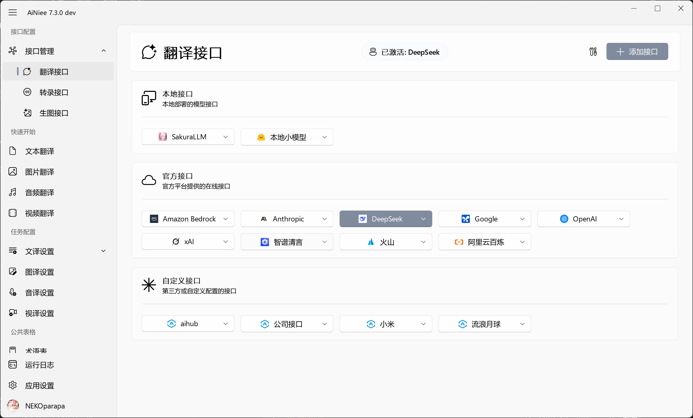
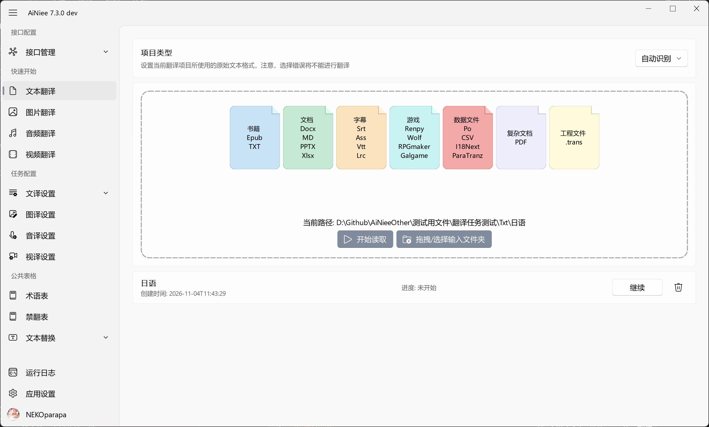
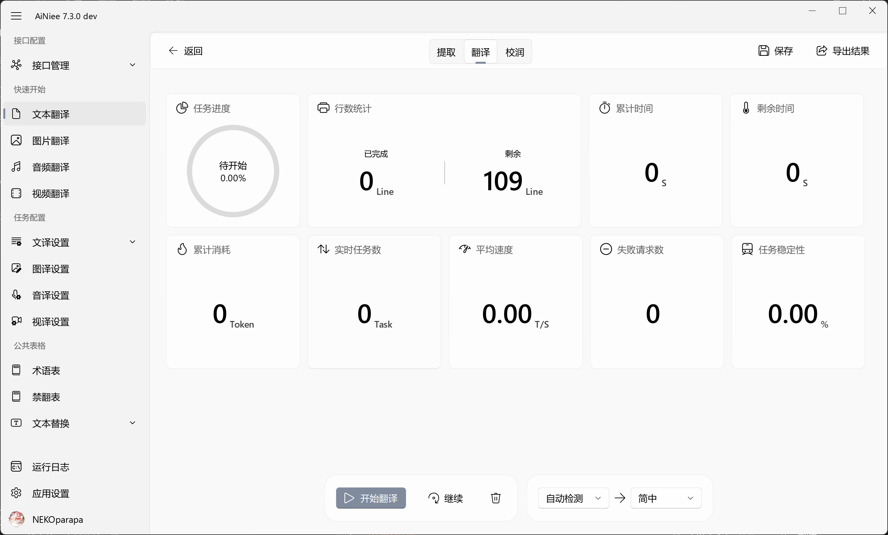

  

  <a href="README_EN.md">English</a> | 简体中文

---

## 软件介绍🧾 

  

<strong>AiNiee</strong> 是一款专注于 AI 多模态翻译的工具， 一键自动翻译游戏、书籍、文档、字幕，以及漫画图片、播客音频与视频内容。

* **格式全能，覆盖广泛**
    * 🎮 **游戏翻译**：深度支持 Mtool, Renpy, Translator++, ParaTranzr, VNText, SExtractor 等游戏文本导出工具。
    * 📚 **文档与字幕**：轻松处理 I18Next/.trans/Po/CSV 数据、Epub/TXT 电子书、Srt/Ass/Vtt/Lrc 字幕、Word/PDF/MD/PPT 文档等。

* **多模态进阶，视听全包**
    * 🖼️ **图片/漫画翻译**：支持整图识别与生成式嵌字翻译，直接输出译图。
    * 🎙️ **音视频翻译**：自动提取视频音轨、语音识别转录（ASR）并翻译，一键导出多格式双语字幕。

* **智能高效，质量出众**
    * 🚀 **极速省心**：一拖一点，自动识别文件与语言；支持接入 MCP 让 AI Agent 自动调度翻译任务。
    * 🎯 **长文与语境优化**：采用思维链翻译、AI术语表、上下文关联、角色与背景设定等技术，支持一键提取术语，确保译文连贯准确。

---

## 项目推荐 ✨

* [**ReaDreamAI**](https://github.com/NEKOparapa/ReaDreamAI)（作者：NEKOparapa） - 阅你所想，绘你所梦，从一个想法到一本完整的精彩小说。ReaDreamAI为你包办写作、插图与视频。
* [**AiNiee-Next**](https://github.com/ShadowLoveElysia/AiNiee-Next)（作者：ShadowLoveElysia） - 针对 AiNiee 核心逻辑进行工程化重构的命令行版本，引入 uv 与运行时稳定性优化，适合长时间挂机、服务器部署及自动化工作流。
* [**ainiee-translate-skill**](https://github.com/xuanji86/ainiee-translate-skill)（作者：xuanji86） - 独立、Agent 原生的小说翻译系统（任意源 → 目标语言，不限中译）

---

## AiNiee三步走 📢

* **第一步：配置接口**
  > 

  - 翻译接口：翻译、转录或生图所调用的AI模型，需要付费使用，[接口设置说明 - DeepSeek](https://github.com/NEKOparapa/AiNiee/wiki/%E5%9C%A8%E7%BA%BF%E6%8E%A5%E5%8F%A3%E2%80%90Deepseek)

* **第二步：拖入文件夹**
  > 
  
  - 输入文件夹：将原文文件单独放置新的文件夹，并将该文件夹拖入框内。小说、字幕、文档、音频、漫画、视频可直接进行翻译，游戏需要文本提取工具或者Agent进行配合。 

* **第三步：开始翻译**

  > 

  - 点击开始按钮，剩下等待任务的完成。

  - [AiNiee下载地址](https://github.com/NEKOparapa/AiNiee/releases)

---

## MCP 服务 🤖

将 AiNiee 接入 [ChatGPT](https://learn.chatgpt.com/docs/extend/mcp)、[DSH（DeepSeek Harness）](https://github.com/deepseek-ai/deepseek-harness/blob/master/packages/mcp/mcp-client/README.md)、[OpenCode](https://opencode.ai/docs/en/mcp-servers) 等支持 MCP 的 Agent 客户端，就可以通过自然语言安排多媒体翻译任务。Agent 通过 MCP 调用 AiNiee 的翻译、转录和生图能力，提交任务、查询进度并获取导出结果。

| 翻译类型 | 你可以这样告诉 Agent |
| --- | --- |
| 📚 文本与文档 | “把这个文件夹里的小说翻译成中文，导出到指定目录。” |
| 🖼️ 图片与漫画 | “把这些漫画图片中的文字翻译成中文，生成 PNG 译图。” |
| 🎵 音频 | “将这段播客转录并翻译成中文，导出双语 SRT 字幕。” |
| 🎬 视频 | “提取这个视频的音轨并翻译语音，导出双语字幕文件。” |

[MCP 功能说明](https://github.com/NEKOparapa/AiNiee/wiki/功能‐REST与MCP#mcp-工具) · [连接配置与调用示例](Backend/MCP.md) · [远程连接](Backend/MCP.md#远程连接)

---

  
## 游戏翻译

 

### 工具准备

 * **`📖游戏文本提取工具`**

      |工具名|介绍|项目类型|
      |:----:|:-----:|:-----:|
      |[Mtool](https://afdian.com/p/d42dd1e234aa11eba42452540025c377)|上手简单，推荐新人使用|Mtool导出文件|
      |[Translator++](https://dreamsavior.net/download/)|上手复杂，功能强大，推荐大佬使用|T++导出文件或Trans工程文件|
      |[ParaTranz](https://paratranz.cn/projects)|上手中等，功能强大，推荐大佬使用|ParaTranz导出文件|
      |[RenPy SDK](https://www.renpy.org/latest.html)|上手中等，功能强大，推荐大佬使用|renpy导出文件|

 * **`🧰本地模型运行工具`**

      |工具名|说明|
      |:----:|:-----:|
      |[Sakura_Launcher_GUI](https://github.com/PiDanShouRouZhouXD/Sakura_Launcher_GUI)|Sakura模型的专属GUI启动器|
      |[LM Studio](https://lmstudio.ai/download) |一个本地部署大语言模型（LLM）平台，致力于简化LLM的使用和管理。|
      |[ollama](https://ollama.com/) |开源跨平台大模型工具 |

  
### 翻译教程

 * **`📺游戏翻译视频教程`**

      |视频链接|说明|
      |:----:|:-----:|
      |[Mtool教程](https://www.bilibili.com/video/BV1h6421c7MA) |初次使用推荐观看|
      |[Translator++教程](https://www.bilibili.com/video/BV1LgfoYzEaX/?share_source=copy_web&vd_source=b0eede35fc5eaa5c382509c6040d6501)|初次使用推荐观看|
      |[Wolf游戏教程](https://www.bilibili.com/video/BV1SnXbYiEjQ/?share_source=copy_web&vd_source=b0eede35fc5eaa5c382509c6040d6501)|初次使用推荐观看|
      |[人名读取教程](https://www.bilibili.com/video/BV1j1VyzqERD/?share_source=copy_web&vd_source=b0eede35fc5eaa5c382509c6040d6501)|进阶翻译推荐观看|

 * **`🎫游戏翻译图文教程`**

      |文章链接|说明|
      |:----:|:-----:|
      |[Mtool教程](https://github.com/NEKOparapa/AiNiee/wiki/%E6%B8%B8%E6%88%8F%E7%BF%BB%E8%AF%91%E2%80%90Mtool) |适合新人，懒人翻译RPG,RenPY,Krkr等游戏，进行外挂式翻译|
      |[Translator++教程](https://github.com/NEKOparapa/AiNiee/wiki/%E6%B8%B8%E6%88%8F%E7%BF%BB%E8%AF%91%E2%80%90Translator--%EF%BC%88%E5%B7%A5%E7%A8%8B%E6%96%87%E4%BB%B6%E7%89%88%EF%BC%89)|适合翻译RPG,RenPY,Krkr等等游戏，进行内嵌式翻译|
      |[Paratranz教程](https://github.com/NEKOparapa/AiNiee/wiki/%E6%B8%B8%E6%88%8F%E7%BF%BB%E8%AF%91%E2%80%90Paratranz)|适合翻译各类大型游戏的MOD|
      |[Unity翻译教程](https://zhuanlan.zhihu.com/p/1894065679927313655)|适合翻译unity游戏|
      |[综合游戏翻译超详细教程](https://www.notion.so/AI-1d43d31f89b280f6bd61e12580652ce5?pvs=4)|适合翻译各类游戏，制作高质量的内嵌补丁|

---

## 功能说明

以下链接直接进入对应的 Wiki 条目，按当前界面的入口查找即可。

| 翻译类型 | 可以做什么 | 使用说明 |
| --- | --- | --- |
| 📚 文本翻译 | 翻译游戏文本、小说、字幕与文档，结合术语提取、上下文和翻译指导，校对后按原格式导出 | [文本翻译](https://github.com/NEKOparapa/AiNiee/wiki/功能‐文本翻译) |
| 🖼️ 图片翻译 | 将原图和翻译要求提交给生图模型，生成译图，并对照原图检查、导出 | [图片翻译](https://github.com/NEKOparapa/AiNiee/wiki/功能‐图片翻译) |
| 🎵 音频翻译 | 将语音转录为带时间戳的字幕，再翻译、试听校对，导出单语或双语字幕 | [音频翻译](https://github.com/NEKOparapa/AiNiee/wiki/功能‐音频翻译) |
| 🎬 视频翻译 | 自动提取视频音轨，转录并翻译语音，在视频画面中同步校对双语字幕，导出字幕文件 | [视频翻译](https://github.com/NEKOparapa/AiNiee/wiki/功能‐视频翻译) |

| 接口与任务配置 | 说明 |
| --- | --- |
| [接口管理](https://github.com/NEKOparapa/AiNiee/wiki/功能‐接口管理) | 翻译、转录、生图接口的配置与激活，功能接口绑定，以及每个翻译接口的独立并发数 |
| [提取设置](https://github.com/NEKOparapa/AiNiee/wiki/设置‐文译设置#提取设置) | 术语与角色提取的批量大小、禁翻项提取、名称合并和提取提示词 |
| [翻译设置](https://github.com/NEKOparapa/AiNiee/wiki/设置‐文译设置#翻译设置) | 文本切分、预处理、上下文、结果检查与输出 |
| [图译设置](https://github.com/NEKOparapa/AiNiee/wiki/设置‐图译设置) | 生成参数、图片翻译提示词、图片格式与文件名后缀 |
| [音译设置](https://github.com/NEKOparapa/AiNiee/wiki/设置‐音译设置) | 说话人识别、长音频切片、字幕格式与文件名后缀 |
| [视译设置](https://github.com/NEKOparapa/AiNiee/wiki/设置‐视译设置) | 视频转录与字幕导出，设置独立于音频任务保存 |
| [提示词与翻译指导](https://github.com/NEKOparapa/AiNiee/wiki/功能‐提示词与翻译指导) | 管理提示词，补充角色介绍、背景设定、翻译风格与翻译示例 |

| 公共表格与其他功能 | 说明 |
| --- | --- |
| [术语表](https://github.com/NEKOparapa/AiNiee/wiki/表格‐AI术语表介绍) | 统一专有名词与期望译法，为模型提供术语说明 |
| [禁翻表](https://github.com/NEKOparapa/AiNiee/wiki/表格‐AI禁翻表介绍) | 保护占位符、标签和需要保留的内容 |
| [文本替换](https://github.com/NEKOparapa/AiNiee/wiki/表格‐文本替换介绍) | 管理译前、译后的普通文本与正则替换规则 |
| [校对与检查](https://github.com/NEKOparapa/AiNiee/wiki/检查（Inspect）) | 在文本工作区查看、编辑译文，使用语言检查辅助定位问题 |
| [应用设置](https://github.com/NEKOparapa/AiNiee/wiki/功能‐应用设置) | 外观与语言、网络与服务、配置导入导出及更新 |
| [REST API](https://github.com/NEKOparapa/AiNiee/wiki/功能‐REST与MCP#rest-处理入口) | 从脚本调用文档、图片、音频和视频处理接口，查询进度与取消任务 |

---

## 特别声明   

该款AI翻译工具仅供个人合法用途,任何使用该工具进行直接或者间接非法盈利活动的行为,均不属于授权范围,也不受到任何支持和认可。

* **`交♂交流群`**:  Q群(反馈与交流)：7296101五零，Q群(聊天吹水)：8216248九零，入群答案：github。备用TG群：https://t.me/+JVHbDSGo8SI2Njhl ,

---

## 赞助💖

