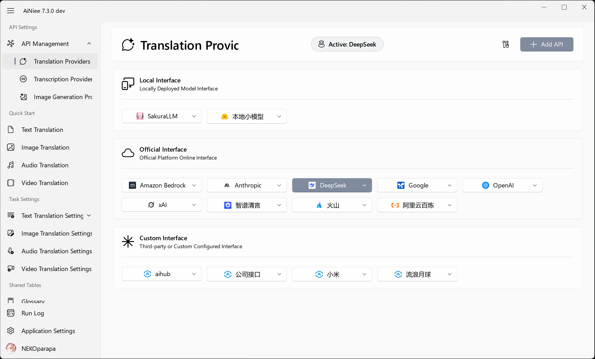
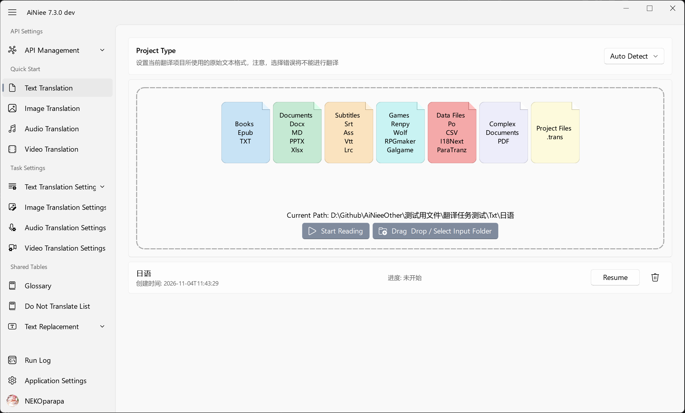
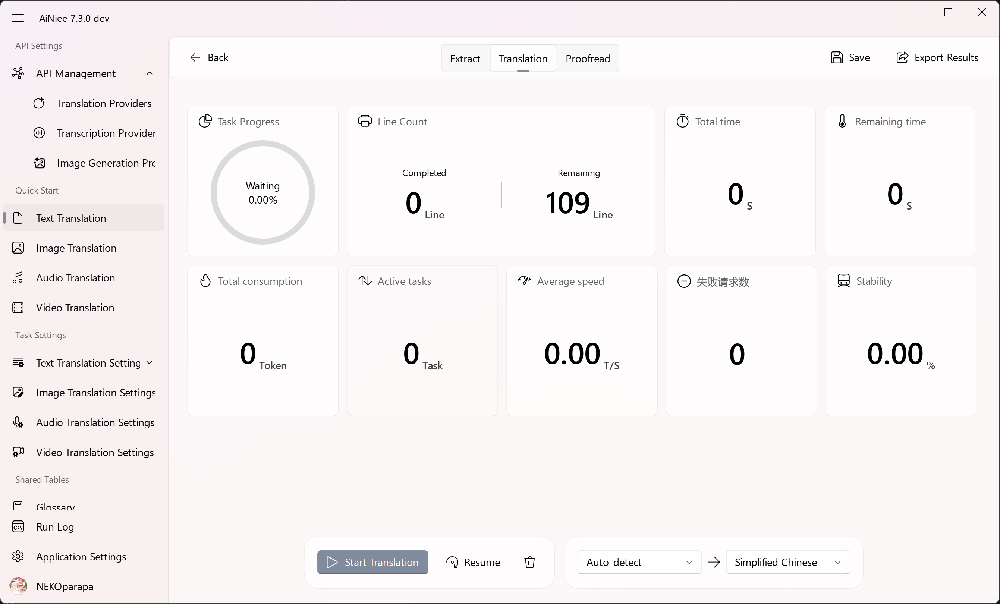

  

  
  
  
 

---

## Introduction🧾 

  

<strong>AiNiee</strong> is a tool specializing in multimodal AI translation, enabling one-click automatic translation of games, books, documents, subtitles, as well as manga/images, audio podcasts, and videos.

*   **All-in-One Format Support, Broad Coverage**
    *   🎮 **Game Translation**: In-depth support for game text export tools like Mtool, Renpy, Translator++, ParaTranzr, VNText, and SExtractor.
    *   📚 **Documents & Subtitles**: Effortlessly processes I18Next/.trans/Po/CSV data, Epub/TXT e-books, Srt/Ass/Vtt/Lrc subtitles, Word/PDF/MD/PPT documents, and more.

*   **Multimodal Capabilities: Image, Audio & Video**
    *   🖼️ **Image & Manga Translation**: Supports full-image recognition and generative typesetting translation, directly outputting translated images.
    *   🎙️ **Audio & Video Translation**: Automatically extracts video audio tracks, transcribes speech (ASR), translates, and exports bilingual subtitles in multiple formats.

*   **Smart, Efficient & Exceptional Quality**
    *   🚀 **Fast & Effortless**: Simply drag and drop to automatically identify files and languages; supports MCP integration for AI Agents to schedule translation tasks automatically.
    *   🎯 **Long-Text & Context Optimization**: Employs chain-of-thought translation, AI glossaries, contextual awareness, and character/background settings, along with table-level AI refinement and one-click terminology extraction for coherent and accurate translations.

---

## Three Steps to Use AiNiee 📢

* **Step 1: Configure Interface**
  > 

  - Translation API: Configure the AI model used for document translation. API usage is billed by the provider. [Setup guide — DeepSeek (Chinese)](https://github.com/NEKOparapa/AiNiee/wiki/在线接口‐Deepseek)
  
* **Step 2: Drag into the folder**
  > 

  - Target Language: In the translation settings, change the target language to the one you need. 

  - Input Folder: Place the source files in a separate folder and drag it into the import area. Novels, subtitles, documents, audio, manga, and videos can be processed directly; games require text extraction tools or an agent to prepare the files. 

* **Step 3: Start Translation**

  > 

  - Click the start button and wait for the task to complete.

  - [AiNiee Download Link](https://github.com/NEKOparapa/AiNiee/releases)

---

## MCP Service 🤖

Connect AiNiee to MCP-enabled agent clients such as [ChatGPT](https://learn.chatgpt.com/docs/extend/mcp), [DSH (DeepSeek Harness)](https://github.com/deepseek-ai/deepseek-harness/blob/master/packages/mcp/mcp-client/README.md), or [OpenCode](https://opencode.ai/docs/en/mcp-servers) to request multimedia translation in natural language. Through MCP, agents can use AiNiee's translation, transcription, and image generation capabilities to submit tasks, check progress, and retrieve exported results.

| Translation type | Example request to your agent |
| --- | --- |
| 📚 Text & documents | “Translate the novels in this folder into English and export them to the specified directory.” |
| 🖼️ Images & manga | “Translate the text in these manga images into English and generate translated PNG images.” |
| 🎵 Audio | “Transcribe this podcast, translate it into English, and export bilingual SRT subtitles.” |
| 🎬 Video | “Extract this video's audio track, translate the speech, and export bilingual subtitle files.” |

[MCP overview](https://github.com/NEKOparapa/AiNiee/wiki/功能‐REST与MCP#mcp-工具) · [Connection setup and examples](Backend/MCP.md) · [Remote connections](Backend/MCP.md#远程连接)

---

## Game Translation

### Tools

**📖 Game text extraction tools**

| Tool | Description | Project type |
| --- | --- | --- |
| [Mtool](https://afdian.com/p/d42dd1e234aa11eba42452540025c377) | An accessible option for beginners | Mtool export |
| [Translator++](https://dreamsavior.net/download/) | More configuration options for experienced users | Translator++ export or `.trans` project |
| [ParaTranz](https://paratranz.cn/projects) | A translation platform for collaborative projects | ParaTranz export |
| [Ren'Py SDK](https://www.renpy.org/latest.html) | Tools for working with Ren'Py games | Ren'Py translation files |

**🧰 Local model tools**

| Tool | Description |
| --- | --- |
| [Sakura_Launcher_GUI](https://github.com/PiDanShouRouZhouXD/Sakura_Launcher_GUI) | A graphical launcher for Sakura models |
| [LM Studio](https://lmstudio.ai/download) | Run and manage local language models |
| [Ollama](https://ollama.com/) | Run language models locally across platforms |

### Tutorials

The linked tutorials are currently in Chinese.

**📺 Video tutorials**

| Tutorial | Focus |
| --- | --- |
| [Mtool](https://www.bilibili.com/video/BV1h6421c7MA) | Getting started with Mtool |
| [Translator++](https://www.bilibili.com/video/BV1LgfoYzEaX/?share_source=copy_web&vd_source=b0eede35fc5eaa5c382509c6040d6501) | Getting started with Translator++ |
| [Wolf games](https://www.bilibili.com/video/BV1SnXbYiEjQ/?share_source=copy_web&vd_source=b0eede35fc5eaa5c382509c6040d6501) | Translating Wolf games |
| [Character names](https://www.bilibili.com/video/BV1j1VyzqERD/?share_source=copy_web&vd_source=b0eede35fc5eaa5c382509c6040d6501) | Advanced character name extraction |

**🎫 Written tutorials**

| Tutorial | Focus |
| --- | --- |
| [Mtool](https://github.com/NEKOparapa/AiNiee/wiki/游戏翻译‐Mtool) | External translation for RPG, Ren'Py, Kirikiri, and other games |
| [Translator++ projects](https://github.com/NEKOparapa/AiNiee/wiki/游戏翻译‐Translator--（工程文件版）) | Exporting and reinserting translations into supported games |
| [ParaTranz](https://github.com/NEKOparapa/AiNiee/wiki/游戏翻译‐Paratranz) | Translating game mods |
| [Unity translation](https://zhuanlan.zhihu.com/p/1894065679927313655) | Translating Unity games |
| [Detailed game translation guide](https://www.notion.so/AI-1d43d31f89b280f6bd61e12580652ce5?pvs=4) | Preparing translation patches for different games |

---

## Feature Description

The links below open the corresponding Wiki articles, organized by the current application menus. Wiki articles are currently in Chinese.

| Translation type | What it does | Guide |
| --- | --- | --- |
| 📚 Text translation | Translate game text, books, subtitles, and documents using terminology extraction, context, and translation guidance; review and export in the corresponding format | [Text translation](https://github.com/NEKOparapa/AiNiee/wiki/功能‐文本翻译) |
| 🖼️ Image translation | Send the original image and instructions to an image generation model, compare the translated image with the original, and export it | [Image translation](https://github.com/NEKOparapa/AiNiee/wiki/功能‐图片翻译) |
| 🎵 Audio translation | Transcribe speech into timed subtitles, translate them, review with audio playback, and export monolingual or bilingual subtitles | [Audio translation](https://github.com/NEKOparapa/AiNiee/wiki/功能‐音频翻译) |
| 🎬 Video translation | Extract an audio track, transcribe and translate speech, review bilingual subtitles in sync with the video, and export subtitle files | [Video translation](https://github.com/NEKOparapa/AiNiee/wiki/功能‐视频翻译) |

| APIs & task settings | Description |
| --- | --- |
| [API management](https://github.com/NEKOparapa/AiNiee/wiki/功能‐接口管理) | Configure and activate translation, transcription, and image generation providers; bind providers to workflows and set concurrency per translation provider |
| [Extraction settings](https://github.com/NEKOparapa/AiNiee/wiki/设置‐文译设置#提取设置) | Set extraction batch size, protected-term extraction, name merging, and extraction prompts |
| [Translation settings](https://github.com/NEKOparapa/AiNiee/wiki/设置‐文译设置#翻译设置) | Configure text splitting, preprocessing, context, output checks, and export |
| [Image translation settings](https://github.com/NEKOparapa/AiNiee/wiki/设置‐图译设置) | Manage generation parameters, image translation prompts, output formats, and filename suffixes |
| [Audio translation settings](https://github.com/NEKOparapa/AiNiee/wiki/设置‐音译设置) | Configure speaker separation, long-audio chunking, subtitle formats, and filename suffixes |
| [Video translation settings](https://github.com/NEKOparapa/AiNiee/wiki/设置‐视译设置) | Configure video transcription and subtitle export independently of audio settings |
| [Prompts & translation guidance](https://github.com/NEKOparapa/AiNiee/wiki/功能‐提示词与翻译指导) | Manage prompts, character descriptions, background information, translation style, and examples |

| Shared tables & other features | Description |
| --- | --- |
| [Glossary](https://github.com/NEKOparapa/AiNiee/wiki/表格‐AI术语表介绍) | Provide consistent terminology, preferred translations, and contextual notes |
| [Do Not Translate list](https://github.com/NEKOparapa/AiNiee/wiki/表格‐AI禁翻表介绍) | Protect placeholders, tags, and text that should remain unchanged |
| [Text replacement](https://github.com/NEKOparapa/AiNiee/wiki/表格‐文本替换介绍) | Manage literal and regular-expression replacements before or after translation |
| [Proofreading & checks](https://github.com/NEKOparapa/AiNiee/wiki/检查（Inspect）) | Review and edit translations, and use language checks to help locate issues |
| [Application settings](https://github.com/NEKOparapa/AiNiee/wiki/功能‐应用设置) | Manage appearance, language, network services, configuration import/export, and updates |
| [REST API](https://github.com/NEKOparapa/AiNiee/wiki/功能‐REST与MCP#rest-处理入口) | Call document, image, audio, and video processing APIs from scripts; query progress and cancel tasks |

---

## Special Statement   
AiNiee's continuous development and iteration to this day is due to ongoing personal research and development of key functional frameworks since the project's inception, user feedback and suggestions, and the joint efforts and creations of contributors through PRs.
This is a process of continuous exploration, improvement, and joint construction over two years, which has formed AiNiee's relatively mature and complete AI translation system today.
Please respect the open-source spirit while using and learning, attribute the source project, and don't forget to give the project a star.

This AI translation tool is for personal legal use only. Any direct or indirect illegal profit-making activities using this tool are not within the scope of authorization and are not supported or endorsed.

* **`Community Groups`**: TG Group: https://t.me/+JVHbDSGo8SI2Njhl

---
